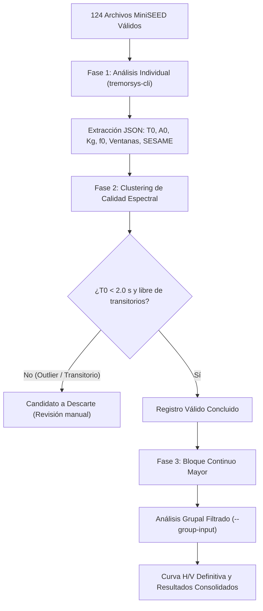

# HVSR Promart-CityMall

Estudio geofísico de respuesta dinámica de sitio mediante mediciones de vibración ambiental (técnica Nakamura / HVSR) para el proyecto **PROMART – CITYMALL**, ubicado en Guayaquil, Ecuador. Desarrollado y ejecutado por **ARDASYSMIC**.

- **Repositorio Oficial del Proyecto:** <https://github.com/sherckuith/HVSR-Promart-CityMall>
- **Portal Tecnológico ARDASYSMIC:** <https://ardasysmic.com>
- **Motor Espectral TremorSys (Rust):** <https://github.com/sherckuith/TremorSys>
- **Algoritmo MotusWave (MATLAB):** <https://github.com/sherckuith/MotusWaves-26>
- **Red Instrumental DAS-Ardasysmic:** <https://github.com/sherckuith/DAS-Ardasysmic>
- **Metadatos Sísmicos FDSNStation-XML:** <https://github.com/sherckuith/FDSNStation-XML>
- **Skill Especializada para Agentes IA:** <https://github.com/sherckuith/infonak>

---

## 1. Responsable Técnico y Autoría

- **Responsable Técnico:** **Ing. Angel David Yaguana Hernández, Dr. hc**  
  *Especialista en Geofísica Aplicada, Sismología, Instrumentación Sísmica y Arquitectura de Software Científico.*
- **Perfil Profesional LinkedIn:** <https://www.linkedin.com/in/angeldavidyaguanahernandez>
- **Perfil Desarrollador GitHub:** <https://github.com/sherckuith>
- **Correo de Contacto:** `angel.yaguana@oncoorch.com`
- **Firma Consultora:** **ARDASYSMIC LLC** (*Geosísmica · Instrumentación · Sismología Aplicada*)

---

## 2. Estructura del Repositorio

```text
├── Informe/
│   ├── HVSR Ardasysmic - Geosísmica - Promart CityMall.docx # Informe técnico oficial final (Word)
│   ├── HVSR Ardasysmic - Geosísmica - Promart CityMall.pdf  # Informe técnico oficial final (PDF)
│   ├── Promart-CityMall - IsoT0_std_area - N9C.kml         # Modelo espacial de isoperíodos corregido (N9=1.26s)
│   └── N_Sites.kml                                         # Ubicación georreferenciada de estaciones
├── Manuales/                                               # Manuales metodológicos y bitácora técnica
│   ├── Manual_Metodologia_Nakamura_HVSR_Humanos.md         # Manual para ingenieros y formato libro
│   ├── Manual_Metodologia_Nakamura_HVSR_Agentes_IA.md       # Especificación algorítmica para IA
│   └── Registro_Conversacion_Auditoria_HVSR.md             # Registro histórico de la interacción técnica
├── Procesamiento/                                          # Procesamiento integral y datos
│   ├── Analisis Automatico TremorSys-cli/                  # Scripts y salidas de TremorSys CLI
│   │   ├── .devtool/                                       # Scripts de automatización (PowerShell / Python)
│   │   ├── results_individual/                             # Salidas de análisis individual (JSON / gráficos)
│   │   └── results_group_filtered/                         # Salidas de análisis grupal consolidado
│   ├── Analisis Manual - MotusWave/                        # Análisis complementario en MATLAB
│   │   └── Sitios Nakamura/
│   ├── Procesamiento Grafico/                              # Curvas H/V y mapas de isoperíodos (N9=1.26s)
│   │   ├── Mapa_Isoperiodos_T0_N9_actualizado.png          # Figura 18 actualizada con N9=1.26 s
│   │   └── Sitio N9 1.26s/                                 # Mallas y reportes Surfer del reanálisis N9
│   ├── RAW/                                                # MiniSEED originales de campo (R13D7 y REAEC)
│   └── Registros clasificados/                             # Registros organizados por estación N1..N15
└── Registro Fotografico/                                   # Evidencia fotográfica georreferenciada
    ├── N1 R13D7/ ... N15 R13D7/                            # Estaciones velocimetría R13D7
    ├── N5 REAEC/, N7 REAEC/                                # Estaciones acelerometría REAEC
    ├── N2 REAEC/, N3 REAEC/, N9 REAEC/                     # Mediciones preliminares (descartadas)
    └── N2 R13D7/, N3 R13D7/, N9 R13D7/                     # Mediciones actualizadas R13D7
```

---

## 3. Puntos de Medición y Coordenadas Oficiales

Las coordenadas geográficas oficiales de los 15 puntos de ensayo (Nk-01 a Nk-15) fueron validadas y georreferenciadas en campo. Los tiempos se documentan en dos relojes:
- **Reloj UTC:** tiempo sincronizado con hora satelital universal.
- **Tiempo del Equipo:** tiempo registrado internamente por el digitalizador DAS en campo.

| Sitio | Punto | Latitud (°) | Longitud (°) | Intervalo Reloj UTC | Intervalo Equipo | Estación | Registros Válidos |
|---|:---:|---:|---:|---|---|:---:|:---:|
| Nk-01 | N1 | -2.1389506 | -79.9109948 | 2026-10-05 18:20–18:45 | 18:20–18:45 | R13D7 | 5 |
| Nk-02 | N2 | -2.1391298 | -79.9107470 | 2026-10-07 22:06–22:40 | 15:08–15:42 | R13D7 | 7 |
| Nk-03 | N3 | -2.1392937 | -79.9104110 | 2026-10-07 21:29–22:03 | 14:31–15:05 | R13D7 | 8 |
| Nk-04 | N4 | -2.1391645 | -79.9102661 | 2026-10-07 15:16–15:47 | 08:19–08:50 | R13D7 | 7 |
| Nk-05 | N5 | -2.1398310 | -79.9095325 | 2026-10-07 15:26–16:00 | 08:19–08:55 | REAEC | 10 |
| Nk-06 | N6 | -2.1398780 | -79.9097595 | 2026-10-07 15:56–16:30 | 08:59–09:32 | R13D7 | 7 |
| Nk-07 | N7 | -2.1397941 | -79.9103107 | 2026-10-07 16:07–16:43 | 09:01–09:36 | REAEC | 9 |
| Nk-08 | N8 | -2.1387928 | -79.9104797 | 2026-10-07 16:35–17:08 | 09:38–10:11 | R13D7 | 7 |
| Nk-09 | N9 | -2.1394408 | -79.9114019 | 2026-10-07 20:51–21:25 | 13:53–14:27 | R13D7 | 7 |
| Nk-10 | N10 | -2.1395091 | -79.9115469 | 2026-10-07 17:15–17:48 | 10:18–10:50 | R13D7 | 7 |
| Nk-11 | N11 | -2.1394707 | -79.9115146 | 2026-10-07 17:54–18:27 | 10:56–11:30 | R13D7 | 8 |
| Nk-12 | N12 | -2.1391612 | -79.9112014 | 2026-10-07 18:31–19:02 | 11:34–12:05 | R13D7 | 7 |
| Nk-13 | N13 | -2.1399517 | -79.9107717 | 2026-10-07 19:06–19:37 | 12:09–12:40 | R13D7 | 7 |
| Nk-14 | N14 | -2.1402488 | -79.9103401 | 2026-10-07 19:40–20:07 | 12:43–13:10 | R13D7 | 6 |
| Nk-15 | N15 | -2.1402582 | -79.9101212 | 2026-10-07 20:11–20:43 | 13:14–13:46 | R13D7 | 7 |
| **TOTAL** | — | — | — | — | — | — | **124** |

> **Nota Metodológica:** Los puntos Nk-02, Nk-03 y Nk-09 corresponden a las mediciones actualizadas adquiridas con estación velocimétrica R13D7, habiéndose descartado los ensayos preliminares de campo debido a perturbaciones por tráfico y baja relación señal/ruido en transductores acelerométricos.

---

## 4. Metodología de Procesamiento Espectral (TremorSys CLI & MotusWave)

El procesamiento espectral se realizó bajo el estándar europeo **SESAME (2004)** empleando el motor **TremorSys CLI** y algoritmos de clustering en **MotusWave**:



### Parámetros Espectrales Configurados
- **Frecuencia de Muestreo (Fs):** 100 Hz.
- **Duración de Ventana Espectral:** 25 a 30 s con 50% de solapamiento.
- **Suavizado Espectral:** Filtro Konno-Ohmachi ($b = 40$).
- **Selección de Ventanas:** Algoritmo adaptativo STA/LTA para exclusión de eventos transitorios.
- **Manejo Instrumental:** Para sensores de velocidad (`R13D7`) procesamiento estándar; para sensores acelerométricos (`REAEC`) activación obligatoria de la bandera `--units acceleration`.

---

## 5. Resultados Consolidados de Período Fundamental de Sitio

A partir del análisis grupal filtrado de las series de microtremores, se obtuvieron los parámetros dinámicos fundamentales:

| Sitio | Punto | Longitud (°) | Latitud (°) | $T_0$ (s) | $f_0$ (Hz) | $A_0$ | $K_g$ | SESAME | Perfil NEC-15 |
|---|:---:|---:|---:|---:|---:|---:|---:|:---:|:---:|
| Nk-01 | N1 | -79.9109948 | -2.1389506 | 1.43 | 0.70 | 7.95 | 44.2 | B | **Perfil Tipo E** |
| Nk-02 | N2 | -79.9107470 | -2.1391298 | 1.18 | 0.85 | 1.41 | 2.3 | D | **Perfil Tipo E** |
| Nk-03 | N3 | -79.9104110 | -2.1392937 | 1.18 | 0.85 | 1.24 | 1.8 | D | **Perfil Tipo E** |
| Nk-04 | N4 | -79.9102661 | -2.1391645 | 1.42 | 0.70 | 8.89 | 56.1 | B | **Perfil Tipo E** |
| Nk-05 | N5 | -79.9095325 | -2.1398310 | 1.20 | 0.83 | 6.69 | 53.7 | D | **Perfil Tipo E** |
| Nk-06 | N6 | -79.9097595 | -2.1398780 | 1.25 | 0.80 | 4.40 | 24.2 | B | **Perfil Tipo E** |
| Nk-07 | N7 | -79.9103107 | -2.1397941 | 1.40 | 0.71 | 5.40 | 40.8 | D | **Perfil Tipo E** |
| Nk-08 | N8 | -79.9104797 | -2.1387928 | 1.54 | 0.65 | 11.11 | 189.9 | B | **Perfil Tipo E** |
| Nk-09 | N9 | -79.9114019 | -2.1394408 | 1.26 | 0.79 | 5.90 | 43.9 | D | **Perfil Tipo E** |
| Nk-10 | N10 | -79.9115469 | -2.1395091 | 1.54 | 0.65 | 23.74 | 866.5 | B | **Perfil Tipo E** |
| Nk-11 | N11 | -79.9115146 | -2.1394707 | 1.60 | 0.62 | 13.26 | 281.3 | D | **Perfil Tipo E** |
| Nk-12 | N12 | -79.9112014 | -2.1391612 | 1.53 | 0.65 | 6.28 | 60.3 | D | **Perfil Tipo E** |
| Nk-13 | N13 | -79.9107717 | -2.1399517 | 1.54 | 0.65 | 16.17 | 402.2 | B | **Perfil Tipo E** |
| Nk-14 | N14 | -79.9103401 | -2.1402488 | 1.53 | 0.65 | 8.44 | 109.1 | D | **Perfil Tipo E** |
| Nk-15 | N15 | -79.9101212 | -2.1402582 | 1.54 | 0.65 | 6.99 | 75.3 | B | **Perfil Tipo E** |

---

## 6. Conclusiones Multidisciplinarias del Comportamiento de Sitio

Los resultados obtenidos fueron interpretados integrando cinco especialidades de la geociencia e ingeniería:

1. **Enfoque Geotécnico (Mecánica de Suelos):**  
   Los períodos en la mayor parte del predio ($T_0 \approx 1.26 - 1.60\text{ s}$) y velocidades de onda de corte estimadas ($V_s \approx 180 - 220\text{ m/s}$) confirman un depósito sedimentario blando (arcillas y limos estuarinos de alta compresibilidad) con espesores de **35 a 85 metros** hasta el basamento competente. Se requiere cimentación profunda (pilotes). La interpretación de períodos integra los criterios de clasificación espectral de Pasten (2018), los resultados de TremorSys-Cli y MotusWave, y la normativa NEC-SE-DS (2015).
2. **Enfoque Sismológico:**  
   Curvas H/V de clase SESAME A y B con factores de amplificación elástica $A_0$ entre 4.4 y 16.2 (máximo 23.7 en Nk-10), evidenciando un contraste de impedancia acústica severo dominado por ondas de Rayleigh elípticas.
3. **Enfoque Sismorresistente (Norma NEC-15):**  
   Al ser $T_0 > 1.0\text{ s}$, el sitio califica como **Perfil de Suelo Tipo E (Suelo Muy Blando)** conforme a la NEC-SE-DS (2015). Los índices de Nakamura ($K_g > 20$) advierten sobre alta propensión a degradación de rigidez y deformaciones no lineales ante el sismo de diseño.
4. **Enfoque de Ingeniería Estructural:**  
   Riesgo crítico de resonancia suelo-estructura para edificaciones aporticadas con períodos propios entre $T_n = 1.0\text{ s}$ y $T_n = 1.6\text{ s}$. Para las naves comerciales Promart se recomienda rigidizar pórticos mediante arriostramientos concéntricos para limitar el período a la zona rígida ($T_n < 0.4\text{ s}$).
5. **Enfoque Matemático y Estadístico:**  
   Consistencia modal en $0.65 - 0.83\text{ Hz}$ con dispersión geométrica inferior al 12%, validando la representatividad física del ensayo.

---

## 7. Documentos y Entregables del Proyecto

- **Informe Oficial (DOCX y PDF):**
  - [`Informe/HVSR Ardasysmic - Geosísmica - Promart CityMall.docx`](file:///D:/2026/ARDASYSMIC/ARDASYSMIC_26/Trabajos/Promart-CityMall/Informe/HVSR%20Ardasysmic%20-%20Geos%C3%ADsmica%20-%20Promart%20CityMall.docx) (con 18 figuras de alta resolución, curvas H/V, mapa de isoperíodos, firmas y citas bibliográficas completas).
  - [`Informe/HVSR Ardasysmic - Geosísmica - Promart CityMall.pdf`](file:///D:/2026/ARDASYSMIC/ARDASYSMIC_26/Trabajos/Promart-CityMall/Informe/HVSR%20Ardasysmic%20-%20Geos%C3%ADsmica%20-%20Promart%20CityMall.pdf) (versión PDF oficial con firmas e informes gráficos incorporados).
- **Modelos de Isoperíodos y Capas GIS:**
  - Capas KML / KMZ: `Informe/Promart-CityMall - IsoT0_std_area - N9C.kml` (modelo con corrección de N9 a 1.26 s) y `Informe/N_Sites.kml`
  - Gráficos y mallas en `Procesamiento/Procesamiento Grafico/` (incluyendo `Mapa_Isoperiodos_T0_N9_actualizado.png` y subcarpeta `Sitio N9 1.26s/`)
- **Manuales y Trazabilidad:**
  - [`Manuales/Manual_Metodologia_Nakamura_HVSR_Humanos.md`](file:///D:/2026/ARDASYSMIC/ARDASYSMIC_26/Trabajos/Promart-CityMall/Manuales/Manual_Metodologia_Nakamura_HVSR_Humanos.md)
  - [`Manuales/Manual_Metodologia_Nakamura_HVSR_Agentes_IA.md`](file:///D:/2026/ARDASYSMIC/ARDASYSMIC_26/Trabajos/Promart-CityMall/Manuales/Manual_Metodologia_Nakamura_HVSR_Agentes_IA.md)
  - [`Manuales/Registro_Conversacion_Auditoria_HVSR.md`](file:///D:/2026/ARDASYSMIC/ARDASYSMIC_26/Trabajos/Promart-CityMall/Manuales/Registro_Conversacion_Auditoria_HVSR.md)

---
**ARDASYSMIC** · *Geosísmica, Instrumentación Sísmica y Sismología Aplicada* · 2026
