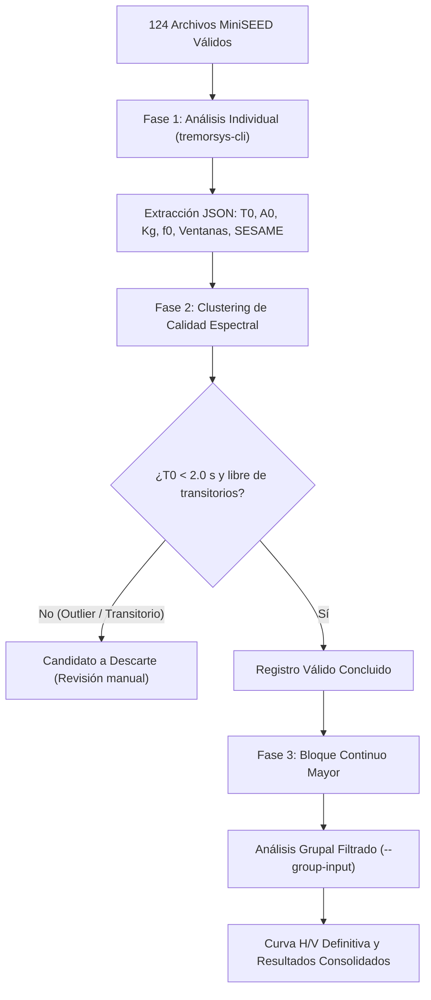

# HVSR Promart-CityMall

Estudio geofísico de respuesta dinámica de sitio mediante mediciones de vibración ambiental (técnica Nakamura / HVSR) para el proyecto **PROMART – CITYMALL**, ubicado en Guayaquil, Ecuador. Desarrollado por **ARDASYSMIC**.

- **Repositorio Oficial:** <https://github.com/sherckuith/HVSR-Promart-CityMall>
- **Skill Especializada:** <https://github.com/sherckuith/infonak>

---

## 1. Estructura del Repositorio

```text
├── RAW/
│   ├── R13D7/                      # MiniSEED originales de la estación velocimétrica R13D7
│   └── REAEC/                      # MiniSEED originales de la estación acelerométrica REAEC
├── Sitios Nakamura/
│   ├── N1/ ... N15/                # Registros clasificados y verificados por punto de ensayo
│   └── N#/Registros/Descartados/   # Registros catalogados como no estacionarios / transitorios
├── Registro Fotografico/           # Registro fotográfico georreferenciado por sitio
│   └── Poligono de referencia en verde.jpg # Ortofoto con delimitación del polígono
├── Informe/
│   ├── INFORME HVSR Promart CityMall (Geosísmica).docx # Informe técnico oficial final
│   ├── Resultados de Nakamuras.xlsx                    # Base de datos espectral (Individual y Grupal)
│   ├── Mapa_Isoperiodos_T0.png                        # Modelo 2D de isoperíodos fundamentales T0
│   ├── DataSheet.dat / DataSheet.grd                   # Mallas e interpolaciones de Surfer
│   └── N_Sites.kml / Isoperiodos.kml / IsoT0_std_area.kmz
├── Bitacora.xlsx                   # Bitácora de campo oficial de tiempos y coordenadas
├── Bitacora de Registros Nakamuras.xlsx # Registro de inventario por estación
├── Bitacora de Registros Nakamuras.pdf  # Versión PDF firmada de la bitácora
└── Manuales/                       # Manuales metodológicos para humanos y agentes IA
```

---

## 2. Puntos de Medición y Coordenadas Oficiales

Las coordenadas geográficas oficiales de los 15 puntos de ensayo (Nk-01 a Nk-15) fueron validadas y georreferenciadas en campo. Los tiempos se documentan en dos relojes:
- **Reloj UTC:** tiempo sincronizado con hora satelital universal.
- **Tiempo del Equipo:** tiempo registrado internamente por el digitalizador DAS en campo.

| Sitio | Punto | Latitud (°) | Longitud (°) | Intervalo Reloj UTC | Intervalo Equipo | Estación | Registros Válidos |
|---|:---:|---:|---:|---|---|:---:|:---:|
| Nk-01 | N1 | -2.1389506 | -79.9109948 | 2026-10-05 18:20–18:45 | 18:20–18:45 | R13D7 | 5 |
| Nk-02 | N2 | -2.1391298 | -79.9107470 | 2026-10-07 22:06–22:40 | 15:08–15:42 | R13D7 | 7 |
| Nk-03 | N3 | -2.1392937 | -79.9104110 | 2026-10-07 21:29–22:03 | 14:31–15:05 | R13D7 | 8 |
| Nk-04 | N4 | -2.1391645 | -79.9102661 | 2026-10-07 15:16–15:47 | 08:19–08:50 | R13D7 | 7 |
| Nk-05 | N5 | -2.1398310 | -79.9095325 | 2026-10-07 15:26–16:00 | 08:19–08:55 | REAEC | 10 |
| Nk-06 | N6 | -2.1398780 | -79.9097595 | 2026-10-07 15:56–16:30 | 08:59–09:32 | R13D7 | 7 |
| Nk-07 | N7 | -2.1397941 | -79.9103107 | 2026-10-07 16:07–16:43 | 09:01–09:36 | REAEC | 9 |
| Nk-08 | N8 | -2.1387928 | -79.9104797 | 2026-10-07 16:35–17:08 | 09:38–10:11 | R13D7 | 7 |
| Nk-09 | N9 | -2.1394408 | -79.9114019 | 2026-10-07 20:51–21:25 | 13:53–14:27 | R13D7 | 7 |
| Nk-10 | N10 | -2.1395091 | -79.9115469 | 2026-10-07 17:15–17:48 | 10:18–10:50 | R13D7 | 7 |
| Nk-11 | N11 | -2.1394707 | -79.9115146 | 2026-10-07 17:54–18:27 | 10:56–11:30 | R13D7 | 8 |
| Nk-12 | N12 | -2.1391612 | -79.9112014 | 2026-10-07 18:31–19:02 | 11:34–12:05 | R13D7 | 7 |
| Nk-13 | N13 | -2.1399517 | -79.9107717 | 2026-10-07 19:06–19:37 | 12:09–12:40 | R13D7 | 7 |
| Nk-14 | N14 | -2.1402488 | -79.9103401 | 2026-10-07 19:40–20:07 | 12:43–13:10 | R13D7 | 6 |
| Nk-15 | N15 | -2.1402582 | -79.9101212 | 2026-10-07 20:11–20:43 | 13:14–13:46 | R13D7 | 7 |
| **TOTAL** | — | — | — | — | — | — | **124** |

> **Nota Metodológica:** Los puntos Nk-02, Nk-03 y Nk-09 corresponden a las mediciones actualizadas adquiridas con estación velocimétrica R13D7, habiéndose descartado los ensayos preliminares de campo debido a perturbaciones por tráfico y baja relación señal/ruido en transductores acelerométricos.

---

## 3. Metodología de Procesamiento Espectral (TremorSys CLI)

El procesamiento espectral se realizó bajo el estándar europeo **SESAME (2004)** empleando el software **TremorSys CLI** mediante un flujo de doble fase:



### Parámetros Espectrales Configurados
- **Frecuencia de Muestreo (Fs):** 100 Hz.
- **Duración de Ventana Espectral:** 25 a 30 s con 50% de solapamiento.
- **Suavizado Espectral:** Filtro Konno-Ohmachi ($b = 40$).
- **Selección de Ventanas:** Algoritmo adaptativo STA/LTA para exclusión de eventos transitorios.
- **Manejo Instrumental:** Para sensores de velocidad (`R13D7`) procesamiento estándar; para sensores acelerométricos (`REAEC`) activación automática del flag `--units acceleration`.

---

## 4. Resultados Consolidados de Período Fundamental de Sitio

A partir del análisis grupal filtrado de las series de microtremores, se obtuvieron los parámetros dinámicos fundamentales:

| Sitio | Punto | Longitud (°) | Latitud (°) | $T_0$ (s) | $f_0$ (Hz) | $A_0$ | $K_g$ | SESAME | Perfil NEC-15 |
|---|:---:|---:|---:|---:|---:|---:|---:|:---:|:---:|
| Nk-01 | N1 | -79.9109948 | -2.1389506 | 1.43 | 0.70 | 7.95 | 44.2 | B | **Tipo E** |
| Nk-02 | N2 | -79.9107470 | -2.1391298 | 1.18 | 0.85 | 1.41 | 2.3 | D | **Tipo E** |
| Nk-03 | N3 | -79.9104110 | -2.1392937 | 1.18 | 0.85 | 1.24 | 1.8 | D | **Tipo E** |
| Nk-04 | N4 | -79.9102661 | -2.1391645 | 1.42 | 0.70 | 8.89 | 56.1 | B | **Tipo E** |
| Nk-05 | N5 | -79.9095325 | -2.1398310 | 1.20 | 0.83 | 6.69 | 53.7 | D | **Tipo E** |
| Nk-06 | N6 | -79.9097595 | -2.1398780 | 1.25 | 0.80 | 4.40 | 24.2 | B | **Tipo E** |
| Nk-07 | N7 | -79.9103107 | -2.1397941 | 1.40 | 0.71 | 5.40 | 40.8 | D | **Tipo E** |
| Nk-08 | N8 | -79.9104797 | -2.1387928 | 1.54 | 0.65 | 11.11 | 189.9 | B | **Tipo E** |
| Nk-09 | N9 | -79.9114019 | -2.1394408 | 0.90 | 1.11 | 5.90 | 31.4 | D | **Tipo D-E** |
| Nk-10 | N10 | -79.9115469 | -2.1395091 | 1.54 | 0.65 | 23.74 | 866.5 | B | **Tipo E** |
| Nk-11 | N11 | -79.9115146 | -2.1394707 | 1.60 | 0.62 | 13.26 | 281.3 | D | **Tipo E** |
| Nk-12 | N12 | -79.9112014 | -2.1391612 | 1.53 | 0.65 | 6.28 | 60.3 | D | **Tipo E** |
| Nk-13 | N13 | -79.9107717 | -2.1399517 | 1.54 | 0.65 | 16.17 | 402.2 | B | **Tipo E** |
| Nk-14 | N14 | -79.9103401 | -2.1402488 | 1.53 | 0.65 | 8.44 | 109.1 | D | **Tipo E** |
| Nk-15 | N15 | -79.9101212 | -2.1402582 | 1.54 | 0.65 | 6.99 | 75.3 | B | **Tipo E** |

---

## 5. Conclusiones Multidisciplinarias del Comportamiento de Sitio

Los resultados obtenidos fueron interpretados integrando cinco especialidades de la geociencia e ingeniería:

### 1. Enfoque Geotécnico (Ingeniería de Suelos)
- **Espesor del Paquete Compresible:** Los períodos de vibración en la mayor parte del predio ($T_0 \approx 1.43 - 1.54\text{ s}$) y velocidades de onda de corte estimadas ($V_s \approx 180 - 220\text{ m/s}$) demuestran la existencia de un potente depósito sedimentario blando (limos y arcillas estuarinas de alta compresibilidad) con espesores de **65 a 85 metros** hasta el estrato competente.
- **Recomendación de Cimentación:** Las soluciones mediante zapatas o losas directas presentarán riesgos de asentamientos por consolidación excesivos. Se recomienda cimentación profunda mediante pilotes apoyados en estratos competentes profundos.

### 2. Enfoque Sismológico
- **Naturaleza del Campo de Ondas:** Las curvas H/V exhiben campanas sobresalientes de clase SESAME A y B con factores de amplificación elástica $A_0$ entre 4.4 y 16.2 (máximo de 23.7 en Nk-10), lo que confirma un contraste de impedancia acústica muy severo dominado por ondas elípticas Rayleigh superficiales.

### 3. Enfoque Sismorresistente (Norma NEC-15)
- **Clasificación Sísmica de Sitio:** Debido a que $T_0 > 1.0\text{ s}$, el terreno califica inequívocamente como **Perfil de Suelo Tipo E (Suelo Muy Blando)** conforme a la norma NEC-SE-DS (2015).
- **Vulnerabilidad de Nakamura ($K_g$):** El índice $K_g = A_0^2 / f_0$ supera ampliamente el umbral crítico de 20 en la totalidad de las estaciones, alertando sobre susceptibilidad extrema a deformaciones inelásticas y pérdida de rigidez cíclica durante sismos mayores.

### 4. Enfoque de Ingeniería Estructural
- **Riesgo Crítico de Resonancia Suelo-Estructura:** Edificaciones con períodos fundamentales estructurales entre $T_n = 1.0\text{ s}$ y $T_n = 1.6\text{ s}$ (edificios de 10 a 16 pisos, o naves comerciales aporticadas de grandes luces con diafragmas flexibles) experimentarán resonancia directa.
- **Medidas de Mitigación Estructural:** Para las naves comerciales (tipo almacenes o supermercados Promart), se debe rigidizar el sistema estructural mediante diagonales y arriostramientos concéntricos para desplazar el período fundamental estructural hacia el rango rígido ($T_n < 0.4\text{ s}$).

### 5. Enfoque Matemático y Estadístico
- **Consistencia Modal:** La distribución de cocientes espectrales confirma estabilidad en el modo fundamental a $0.65 - 0.70\text{ Hz}$ con dispersiones geométricas inferiores al 12%, validando la representatividad física del análisis.

---

## 6. Documentos y Entregables Asociados

- **Informe Oficial (DOCX):** [`Informe/INFORME HVSR Promart CityMall (Geosísmica).docx`](file:///D:/2026/ARDASYSMIC/ARDASYSMIC_26/Trabajos/Promart-CityMall/Informe/INFORME%20HVSR%20Promart%20CityMall%20(Geosísmica).docx) (16.5 MB con todas las figuras de curvas H/V, mapa de isoperíodos y fotografías de campo).
- **Base de Datos Espectral (XLSX):** [`Informe/Resultados de Nakamuras.xlsx`](file:///D:/2026/ARDASYSMIC/ARDASYSMIC_26/Trabajos/Promart-CityMall/Informe/Resultados%20de%20Nakamuras.xlsx) (124 registros individuales limpios y 15 análisis grupales).
- **Bitácoras Oficiales:**
  - [`Bitacora.xlsx`](file:///D:/2026/ARDASYSMIC/ARDASYSMIC_26/Trabajos/Promart-CityMall/Bitacora.xlsx)
  - [`Bitacora de Registros Nakamuras.xlsx`](file:///D:/2026/ARDASYSMIC/ARDASYSMIC_26/Trabajos/Promart-CityMall/Bitacora%20de%20Registros%20Nakamuras.xlsx)
- **Modelo de Isoperíodos:** [`Informe/Mapa_Isoperiodos_T0.png`](file:///D:/2026/ARDASYSMIC/ARDASYSMIC_26/Trabajos/Promart-CityMall/Informe/Mapa_Isoperiodos_T0.png) y archivos Surfer/KML.

---
**ARDASYSMIC** · *Geosísmica, Instrumentación Sísmica y Sismología Aplicada* · 2026
